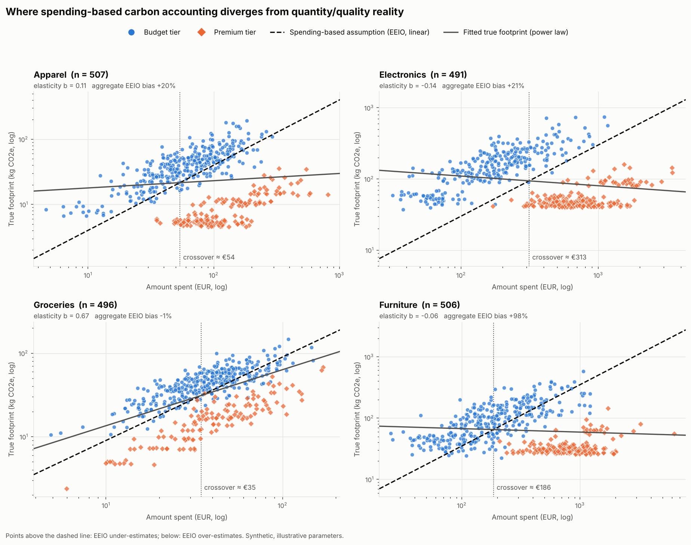

# footprint-decoupler

A small, reproducible Python tool that shows where **spending-based carbon footprints** (environmentally extended input-output, EEIO) diverge from a **quantity/quality-based** account of the same purchases.

Standard EEIO footprints assume emissions scale linearly with money spent: `E = spend × intensity`. A large bill can, however, mean many cheap units (high quantity) or one durable premium unit (high quality). This tool separates the two on a synthetic household ledger, measures how wrong the linear assumption is, and locates the spending level at which the error changes sign.



> **Status.** This is a method prototype on **synthetic data with illustrative parameters**. No number it produces is an empirical estimate. The roadmap below describes how to replace each assumption with EXIOBASE multipliers and observed data.

---

## The idea in one equation

For a transaction with quantity *q*, unit price *p* and product category *c*:

```
EEIO = I_c · q · p
LCA  = q · m_c · EF_c · μ_tier · D(θ)        D(θ) = 1 / (1 + g_c · θ)
```

`I_c` is the sector intensity (kg CO2e/EUR), `m_c` the mass per unit, `EF_c` a mass-based emission factor, `μ_tier` the extra material in a premium unit, and `D(θ)` a durability discount driven by a quality index θ ∈ [0, 1].

Quantity cancels in the ratio:

```
ln(EEIO / LCA) = ln(I_c / (m_c · EF_c))   category constant
               + ln(p)                    price effect
               − ln(μ_tier · D(θ))        quality effect
```

So the gap between the two accounts is driven entirely by **price per physical unit and quality**, never by volume. That is the blind spot: within a product category, EEIO treats a higher unit price as proportionally more emissions, when in reality it largely buys quality.

## What the tool does

1. **Generates a synthetic ledger.** Categories: Apparel, Electronics, Groceries, Furniture. Quality tier is Bernoulli, quantity is Gamma, the quality index is Beta by tier, and unit price is log-normal. Equal spending therefore arises from both bulk budget baskets and single premium items.
2. **Computes two footprints.** `calculate_standard_eeio` (spend × intensity) and `calculate_decoupled_lca` (quantity × mass × emission factor × quality coefficient, independent of spend).
3. **Decomposes the error**, per category:
   - the spend elasticity *b* of the true footprint (`scipy.stats.linregress` on logs; EEIO implicitly assumes *b* = 1);
   - the **crossover spend** where EEIO switches from under- to over-estimating, with a bootstrap 95% CI;
   - a variance attribution of `ln(EEIO/LCA)` into price and quality shares;
   - a Mann-Whitney U test of the budget vs premium gap.
4. **Plots** spend vs true footprint by tier, with the linear EEIO assumption dashed.

It can also read an observed ledger (`--input`), validates every row, and reports rejected rows rather than failing.

## Install

Requires Python ≥ 3.9.

```bash
pip install -r requirements.txt
```

## Usage

```bash
python footprint_decoupler.py --records 2000 --plot --export-csv results/ledger.csv
```

| Flag | Meaning |
|---|---|
| `--records N` | Number of synthetic transactions (default 500) |
| `--input PATH` | Analyse a CSV ledger instead of synthetic data |
| `--export-csv PATH` | Write the enriched ledger, plus `<stem>_decomposition.csv` and `<stem>_rejected.csv` |
| `--plot` / `--plot-path` | Save the figure (default `emissions_divergence.png`) |
| `--calibrate-eeio` | Set intensities so category totals match the LCA totals, leaving only distributional bias |
| `--seed N` | Reproducibility (default 42; `-1` for a random run) |
| `--bootstrap N` | Resamples for the crossover CI (default 500) |
| `--json` | Print the decomposition table as JSON |

The input schema is `transaction_id, category, amount_spent, true_quantity, true_quality_tier[, quality_index]`. The column names in `synthetic_schema_seed.csv` (`implied_item_count`, `perceived_quality_tier`) are accepted as aliases.

## Sample run

```text
$ python footprint_decoupler.py --records 2000 --plot --export-csv results/ledger.csv
==============================================================================
FOOTPRINT DECOUPLER - spending-based vs quantity/quality accounting
==============================================================================
Valid records: 2000   rejected: 0
EEIO intensities: fixed defaults
Total EEIO footprint :    197,481.1 kg CO2e
Total LCA footprint  :    140,181.5 kg CO2e
Aggregate EEIO bias  : +40.9%
Transactions over-estimated by EEIO: 44.4%

[Apparel]  n = 507   I = 0.400 kg/EUR
  aggregate bias +19.7%   over-estimated share 42%
  median EEIO/LCA ratio  budget 0.63   premium 6.40   (Mann-Whitney p = 6.7e-75)
  log-ratio variance: price effect 84%, quality effect 16%
  spend elasticity of true footprint b = 0.111 (SE 0.054, R2 0.01); EEIO assumes 1
  crossover spend ≈ EUR 54 [95% CI 50 - 59]: EEIO under-estimates below, over-estimates above

[Electronics]  n = 491   I = 0.300 kg/EUR
  aggregate bias +20.5%   over-estimated share 44%
  median EEIO/LCA ratio  budget 0.34   premium 4.35   (Mann-Whitney p = 1.7e-80)
  log-ratio variance: price effect 93%, quality effect 7%
  spend elasticity of true footprint b = -0.136 (SE 0.032, R2 0.03); EEIO assumes 1
  crossover spend ≈ EUR 313 [95% CI 297 - 331]: EEIO under-estimates below, over-estimates above
  ...
```

**Reading it.** For Apparel, EEIO puts a premium purchase at about 6× its physical footprint and a budget purchase at about 0.6×. The two tiers are mis-measured in opposite directions. Below roughly €54 per transaction, the spending-based method under-counts. Above it, the method over-counts.

With `--calibrate-eeio` the aggregate bias is zero by construction, yet 39% of transactions are still over-estimated. The bias is **distributional**: it moves footprint between high- and low-spending households even when the national total is right. That matters for any analysis of footprints by income.

**Caveat on the fit.** The low R² is the substantive finding, not a defect: within a category, the physical footprint barely tracks spending. The power-law line is a summary used to locate the crossover, not a model of the data.

---

## Roadmap: from synthetic prototype to EXIOBASE-calibrated estimates

Every illustrative parameter is replaced in turn. Each stage is usable on its own.

### Stage 1. Replace the EEIO intensities with EXIOBASE 3 multipliers

- Download and parse EXIOBASE 3 (product-by-product, `pxp`) for the analysis year with [`pymrio`](https://github.com/IndEcol/pymrio) (`download_exiobase3`, `parse_exiobase3`, `calc_all`).
- Take the total (direct + indirect) GWP100 multipliers from the impacts extension. Check the exact row label in the version you download.
- Build **consumption-based intensities for Swedish households**. Weight each product's multipliers across the 49 regions by the origin shares of Swedish household final demand, so that imports are included.
- Convert from basic to **purchaser's prices**, because household transactions are recorded at purchaser's prices. Bridge with trade/transport margins and product taxes from the Statistics Sweden supply-use tables.
- Map COICOP household-budget categories to EXIOBASE products with a published concordance. Deflate to the ledger year and convert EUR to SEK.
- **Output:** `I_c` in kg CO2e per SEK (purchaser's prices) for each COICOP category, replacing `CategoryParams.eeio_intensity`.

### Stage 2. Ground physical quantities in unit-value data

- For each product, derive **unit values** (value per kg or per item) from trade statistics (CN8 import value and net mass) and production statistics (PRODCOM).
- The within-product distribution of unit values replaces the synthetic log-normal price model, and mass per unit replaces `mass_per_unit`.
- Firm-level emission intensities, where available, give the producer side of the variation: the same product can be made more or less carbon-intensively.

### Stage 3. Estimate the quality effect instead of assuming it

- The prototype **assumes** the durability function `D(θ)`. The research question is to **estimate** it.
- The key parameter is the within-product elasticity of emissions per unit with respect to unit price. EEIO implicitly fixes it at 1, a mass-based account at 0, and the truth lies between.
- Estimate it from the matched transaction and unit-value data (stages 2 and 4), with product fixed effects. Use LCA studies of matched budget and premium products (apparel, electronics, furniture) to bound the durability side.
- `quality_coefficient()` then becomes an estimated function with standard errors, not a parameter table.

### Stage 4. Run on real transaction ledgers

- Map merchant or product codes in bank or receipt data to COICOP. The `--input` path and the row validation already exist for this.
- Replace the binary budget/premium tier with a continuous quality index estimated from price position within the product (stage 3).

### Stage 5. Uncertainty and validation

- Propagate uncertainty in the multipliers, unit values and quality elasticity by Monte Carlo, alongside the existing bootstrap.
- Benchmark corrected household footprints against published Swedish consumption-based statistics. Report how the income gradient of footprints changes once the quality bias is removed.

## Limitations

- Synthetic data and illustrative parameters throughout. They are internally consistent, not calibrated.
- Only four categories. Services, which have no physical-quantity analogue, are out of scope.
- Durability is a single scalar. A full treatment would model lifetimes, use-phase emissions and second-hand markets.

## Repository contents

| File | Purpose |
|---|---|
| `footprint_decoupler.py` | The tool (single file, CLI) |
| `requirements.txt` | Dependencies |
| `synthetic_schema_seed.csv` | Example input schema |
| `emissions_divergence.png` | Figure from the sample run |

## Author

Rezi Kotrikadze, MSc Environmental Management and Policy, IIIEE, Lund University. Prototype developed in October 2026 alongside an application to the Chalmers doctoral project *Quantity or quality? Rethinking carbon footprints and demand-side policy*.
